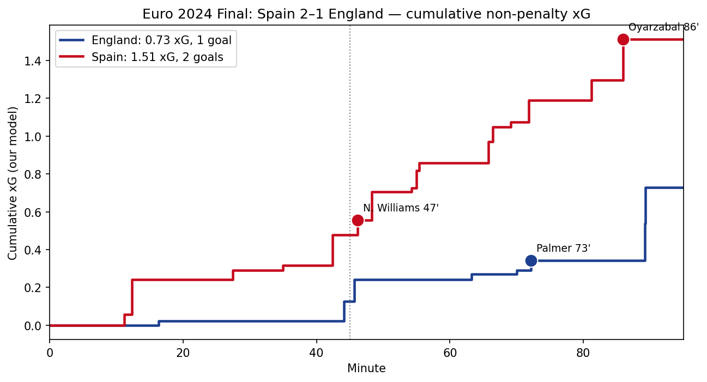
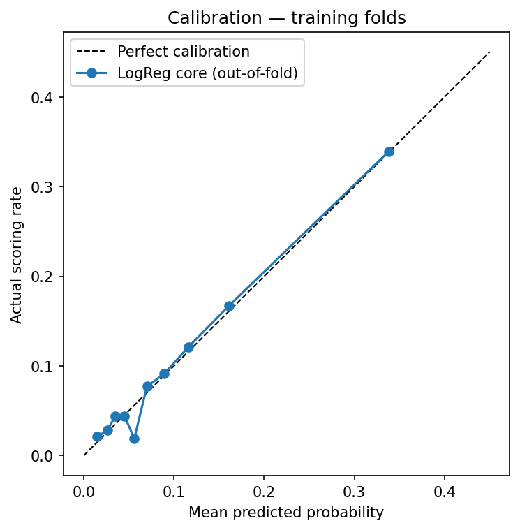
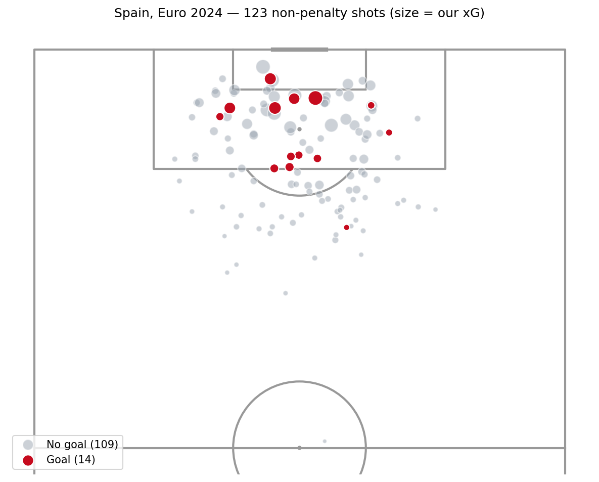

# Football xG Modelling and Chance Analysis

An expected goals (xG) model for non-penalty shots, built with **Hudl StatsBomb Open Data**: trained on three international tournaments, evaluated on a later one (Euro 2024), and then used to analyse how Spain created and conceded chances on their way to the title.



---

## At a glance

| | |
|---|---|
| **Question** | How well can we estimate the probability that a non-penalty shot becomes a goal, using only information available at the moment of the shot? |
| **Data** | 230 matches · 5,606 non-penalty shots · 507 goals (World Cup 2018, Euro 2020, World Cup 2022, Euro 2024) |
| **Split** | Train and validate on 2018–2022 (4,302 shots); evaluate on Euro 2024 (1,304 shots, 98 goals) |
| **Main model** | Logistic regression on shot geometry and context, chosen over tuned gradient boosting under a recorded selection rule |
| **Euro 2024 result** | Log loss **0.2401** vs 0.2692 for a baseline (≈11% lower) · ROC-AUC **0.740** |
| **Extension** | Goalkeeper and defender positions from freeze frames closed **38%** of the log-loss gap to StatsBomb's own xG (exploratory) |

---

## Key findings

**1. Geometry and context improved predictions.**
Distance and angle reduced cross-validated log loss from 0.3145 for the baseline to 0.2799. Adding core shot-context features reduced it further to 0.2713 and improved all five validation folds.

**2. Raw and adjusted comparisons can differ.**
Headers had a higher raw scoring rate than right-foot shots (11.1% versus 8.5%) but occurred closer to goal. In the fitted model, headers had lower scoring odds than non-headers with the other recorded inputs held fixed. These are conditional associations, not causal effects.

**3. A simpler model was selected.**
Core logistic regression and tuned gradient boosting were practically tied under the paired-fold selection heuristic. Logistic regression was retained for its simplicity and interpretability. Nested cross-validation provided an additional assessment of boosting.

**4. The core model beat the baseline on Euro 2024.**
Log loss was 0.2401 versus 0.2692 for the constant baseline, with ROC-AUC of 0.740. StatsBomb xG performed better as a reference, although its training history relative to these matches is unknown.

**5. Recorded player positions were a promising extension.**
Goalkeeper and defender features added predictive information in the exploratory comparisons. Development was informed by Euro 2024 error inspection, so improvement requires confirmation on new data.

**6. Spain generated more total non-penalty xG than their opponents.**
The core model assigned Spain 9.94 xG and their opponents 6.24 across seven matches. Spain scored 14 non-penalty goals from recorded shots and conceded three. In the final, the corresponding xG totals were 1.51 for Spain and 0.73 for England. These figures describe shot opportunities, not possession control or proof of finishing ability.

---

## Results

### Model selection (5-fold cross-validation grouped by match, training tournaments)

| Model | Log loss ↓ | Brier ↓ | ROC-AUC ↑ |
|---|---:|---:|---:|
| Baseline (training scoring rate) | 0.3145 | 0.0861 | 0.500 |
| Logistic regression: distance + angle | 0.2799 | 0.0788 | 0.744 |
| **Logistic regression: core features (chosen)** | **0.2713** | **0.0761** | **0.765** |
| Gradient boosting: core features (nested CV) | 0.2727 | — | — |

### Evaluation on Euro 2024 (1,304 shots, 98 goals)

| Model | Log loss ↓ | Brier ↓ | ROC-AUC ↑ | Total xG |
|---|---:|---:|---:|---:|
| Baseline (training scoring rate) | 0.2692 | 0.0699 | 0.500 | 124.0 |
| **Core logistic regression (main result)** | **0.2401** | **0.0651** | **0.740** | **111.5** |
| Core + freeze-frame features (exploratory) | 0.2344 | 0.0640 | 0.764 | 109.0 |
| StatsBomb xG (reference) | 0.2251 | 0.0615 | 0.787 | 111.4 |

<p>
  
  
</p>

*Left: calibration of out-of-fold predictions on the training tournaments. Right: Spain's non-penalty shots at Euro 2024, sized by core-model xG. Shot maps show the attacking half only; shots taken from outside it are counted in the legend but not drawn.*

---

## Method

1. **Data and quality checks:** downloaded event data for 230 matches; built one row per shot; removed 142 shootout attempts and 81 in-game penalties; checked duplicates, missing values and coordinates.
2. **Predictor restrictions:** outcome, post-shot fields and StatsBomb xG were excluded from model inputs. A column-name assertion checks explicitly forbidden predictors; it is not a complete leakage audit.
3. **Feature checks against the specification:** `one_on_one` (not defined in the StatsBomb event specification) and `technique` ("Lob" is defined by post-contact trajectory) were excluded from the main model and tested only as a sensitivity check.
4. **Validation:** 5-fold `GroupKFold` by match, so shots from the same match never appear in both training and validation. All preprocessing sits inside scikit-learn pipelines.
5. **Recorded selection rule:** log loss was the primary metric. Paired fold differences and a practical one-SE heuristic guided preference for simpler models. Some exploratory results were viewed before the rule was recorded.
6. **Calibration** checked on out-of-fold training predictions before the evaluation tournament was scored.
7. **Uncertainty:** 2,000 bootstrap resamples of whole Euro 2024 matches, with paired comparisons.
8. **Error analysis** by shot type, distance band and individual shots, which motivated the freeze-frame extension.
9. **Freeze-frame extension:** goalkeeper distance from goal, goalkeeper inside the shooting triangle, defenders in the shooting triangle, and distance to the nearest defender.

---

## Limitations

- Four men's international tournaments only; results may not transfer directly to club football.
- One evaluation tournament with 98 goals, so evaluation metrics carry substantial uncertainty (core-model ROC-AUC interval ≈ 0.69–0.79).
- Freeze frames record visible players at the moment of the shot; they are not continuous tracking data.
- The freeze-frame extension was developed after inspecting Euro 2024 errors, so its Euro 2024 result is exploratory and needs confirmation on new data. Its paired bootstrap interval against the core model (−0.0125 to +0.0009) just includes zero.
- Some descriptive Euro 2024 outcomes were inspected during data checks, and some model results were seen before the selection rule was written down. Both are disclosed in the notebook.
- Coefficients are conditional associations, not causal effects. xG measures chance quality, not finishing ability or whether a team deserved a result.
- StatsBomb's xG is a reference with an unknown training history relative to these matches.

---

## Repository contents

```
├── Football_xG_Modelling_and_Chance_Analysis.ipynb   # full analysis, Sections 1–11
├── figures/                                          # charts used in this README
│   ├── eda_shot_map.png
│   ├── fold_log_loss.png
│   ├── calibration_training.png
│   ├── spain_shot_map.png
│   └── final_xg_timeline.png
├── requirements.txt
└── README.md
```

Raw data is not stored in this repository. The notebook downloads it from the StatsBomb Open Data repository and caches it in `data/raw/` on first run.

---

## How to run

**Google Colab:** open the notebook and choose **Runtime → Run all**. The first run downloads about 230 match files (1–2 minutes).

**Locally:**

```bash
git clone https://github.com/asmeromberhane/football-xg-modelling-and-chance-analysis.git
cd football-xg-modelling-and-chance-analysis
pip install -r requirements.txt
pip install notebook          # if Jupyter is not already installed
jupyter notebook Football_xG_Modelling_and_Chance_Analysis.ipynb
```

Tested with Python 3, numpy 2.4.6, pandas 2.2.3, scikit-learn 1.6.1, matplotlib 3.10.0 and mplsoccer 1.8.1. A random seed of 42 is used throughout. Cross-validation fold assignment can differ slightly between scikit-learn versions.

---

## Data and attribution

Data provided by **Hudl StatsBomb** through the [StatsBomb Open Data](https://github.com/statsbomb/open-data) repository, used under its user agreement. Pitch drawings use [mplsoccer](https://github.com/andrewRowlinson/mplsoccer).

**Data version:** files are downloaded from the repository's `master` branch and cached locally. The original retrieval date and source commit were not recorded, so the exact data version used cannot be identified, and future downloads may include revisions. The setup date variable in the notebook records when the environment was initialised, not when the data was retrieved.

---

## Author

**Asmerom Berhane** — MSc Artificial Intelligence (Distinction), University of Huddersfield
